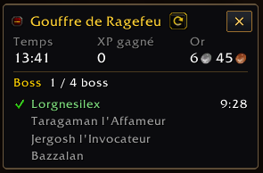
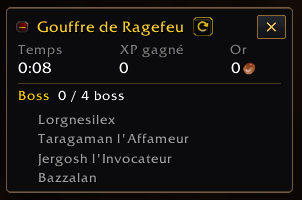
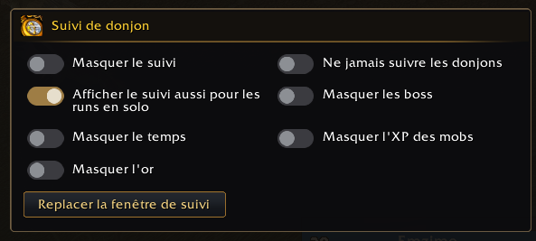

# OneForAll – Dungeon Tracker

An **unofficial** build of [OneForAll](https://discord.gg/JSPUqw4g), the all-in-one WoW Forever companion by **Smoergi**, with an on-screen **dungeon tracker** built in. No plugin and no extra addon: the tracker is part of OneForAll itself.

> This repository only shows a proposed addition. OneForAll belongs to its author: for the official version, updates, support, bug reports and suggestions, join the **[OneForAll Discord](https://discord.gg/JSPUqw4g)**.

Based on OneForAll **6.2.12**. This build is **6.2.12-dt1** (`-dt` = Dungeon Tracker). The suffix marks it as a test build for OneForAll's version check: it never tells other players about a "newer version", and you are still told when the next official version comes out. Screenshots were taken in game with a French client.

---

## Dungeon Tracker

A small window opens when you enter a dungeon or raid and closes when you leave it.

<table align="center"><tr>
<td align="center"> First boss down at 9:28</td>
<td align="center"> After the reset button (next to the name): back to zero</td>
</tr></table>

### What the window shows

- **Time | XP earned | Gold**
  - **Time:** time spent inside the instance. It turns green when the run is done.
  - **XP earned:** XP your character gained inside, minus quest turn-ins. A level-up is counted correctly.
  - **Gold:** money your character gained inside. Only gains count: buying or repairing doesn't lower it.
  - At the level cap, the XP column is replaced by gold, as in Dungeon Journal.
  - Only your own character is counted, never the whole group.
- **Bosses:**
  - The dungeon's bosses, in the order of OneForAll's own data and in the chosen language.
  - Each killed boss gets a green tick and the time it died.
  - A counter shows progress (e.g. *1 / 4 bosses*).
  - Rare and summoned bosses are optional: they are listed once killed but don't block completion.
- **Completion:** the clock stops when every required boss is down. The chat then shows *"Ragefire Chasm completed in 23:41."*

### Same run or new run

- The run continues if you come back within 30 minutes (corpse run, repairs) and survives `/reload`.
- It starts again from zero after an instance reset. The reset is detected:
  - from the game's own reset message;
  - when a boss already ticked is seen alive at full health (for when another group member reset it).
- When neither catches it, the **reset button** next to the dungeon's name starts the run again (with a confirmation), as in Dungeon Journal.

### Handling

- drag to move;
- click the title to fold the boss list;
- reset button (or right-click on the title) to restart;
- click a boss to open it in OneForAll's Dungeons tab;
- the X hides the window for this run.

| Command | Effect |
|---|---|
| `/ofa run` | Shows or hides the window. |
| `/ofa run reset` | Restarts the run. |
| `/ofa run debug` | Shows the tracker's log in the chat (again to hide it). The log is always saved. |

### How kills are detected

WoW Forever doesn't let addons read the combat log, so kills come from:
- `ENCOUNTER_START` / `ENCOUNTER_END` / `BOSS_KILL` when the client sends them;
- a dead boss seen as a unit: target, focus, mouseover, boss frames, nameplates, or the group's targets;
- a corpse you loot.

Bosses are matched by NPC ID, then by name and aliases. Values the client marks as secret are skipped.

**Any client language:** OneForAll's boss names are English, the game's encounter names are not. The tracker learns, per account, the name the client gives each boss and which boss each encounter is (encounter IDs are the same in every language). A kill that could not be matched at first is moved to the right boss as soon as it is known.

## Options

A **Dungeon Tracker** section in **Settings**, with the same options as the Dungeon Journal tracker.

| Option | Effect |
|---|---|
| Hide Tracker | Hides the tracker for this run. Its X ticks this, and a new run unticks it. |
| Never track dungeons | The window never opens by itself. Runs are still recorded, and `/ofa run` still opens it. |
| Show Tracker for solo runs too | Opens the window without a group too (**on** by default). |
| Hide Bosses | No boss list. |
| Hide Time | No time column. |
| Hide XP | No XP column. |
| Hide Gold | No gold column. |
| Reset tracker position | Puts the window back in its default place. |

## Translations

Every new text is translated in all of OneForAll's languages: English, Deutsch, Français, Español, Português (Brasil).

---

## Changed files

Everything else is OneForAll 6.2.12 as released.

| File | Change |
|---|---|
| `OneForAll/UI/DungeonRun.lua` | **New.** The whole tracker (`FLT.DungeonRun`): window, kill detection, boss names learned per language, XP and gold, reset detection, options. |
| `OneForAll/OneForAll.toc` | Loads `UI\DungeonRun.lua` last. Version `6.2.12-dt1`. |
| `OneForAll/QoL.lua` | Defaults for the tracker options (`dungeonRunNever`, `dungeonRunSolo`, `dungeonRunHide*`). |
| `OneForAll/UI/Settings.lua` | New *Dungeon Tracker* section. `s:check()` takes an optional label width: only those labels wrap onto a second line, every other switch is unchanged. |
| `OneForAll/Core.lua` | `/ofa run`, `/ofa run reset`, `/ofa run debug`. |
| `OneForAll/Locales/{deDE,frFR,esES,ptBR}.lua` | Translations of the new texts. |

Saved data:
- `OneForAllCharDB.dungeonRun`: the current run, per character.
- `OneForAllDB.qol.dungeonRun*`: the options, window position and fold.
- `OneForAllDB.dungeonRunLearn`: boss names and encounters learned for this client's language, and the log (last 300 lines).

## Install

1. Download the latest zip from **Releases**, or from the **Actions** tab (artifact of the last build).
2. Close the game, then replace the `OneForAll` folder in your WoW Forever client's `Interface/AddOns` folder with the `OneForAll` folder from the zip.
3. If you used the `OneForAll_DungeonTracker` plugin, delete its folder: this build has the tracker built in.
4. Start the game. The options are in OneForAll → **Settings** → **Dungeon Tracker**.

## Build

`.github/workflows/build.yml` checks every Lua file and builds the zip:
- on every push and pull request, as a workflow artifact;
- when a tag starting with `v` is pushed (e.g. `git tag v6.2.12-dt1 && git push --tags`), also as a GitHub release.

For a new build, raise the suffix in `OneForAll/OneForAll.toc` (`## Version: 6.2.12-dt2`) and tag it the same way (`v6.2.12-dt2`).

## Credits & license

- **OneForAll** © Smoergi, licensed under **GPL-3.0-or-later** (see `OneForAll/LICENSE.txt` and `OneForAll/THIRD_PARTY_LICENSES.txt`). This modified version is under the same license. The changes are listed above.
- The tracker is inspired by the Dungeon Journal tracker (its options and reset button). The code is new and built on OneForAll's own data.
- Official OneForAll, support and suggestions: **https://discord.gg/JSPUqw4g**
